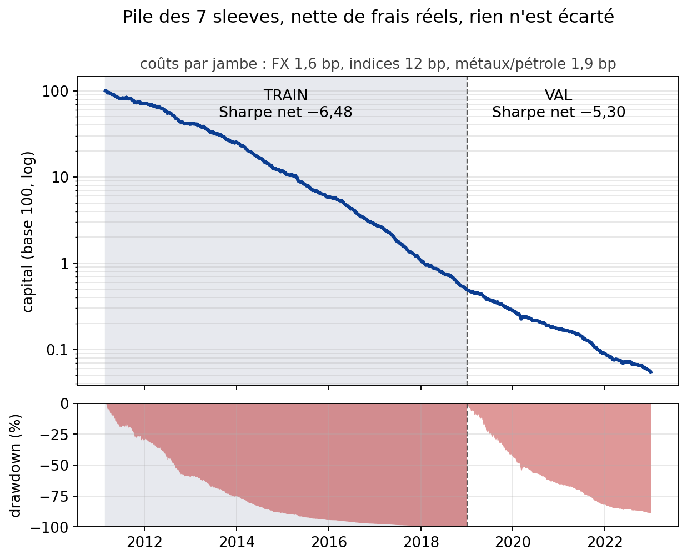
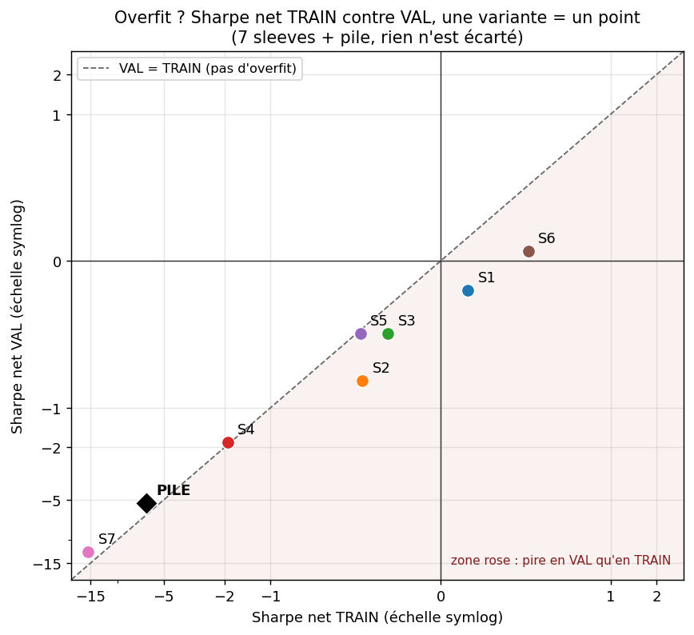
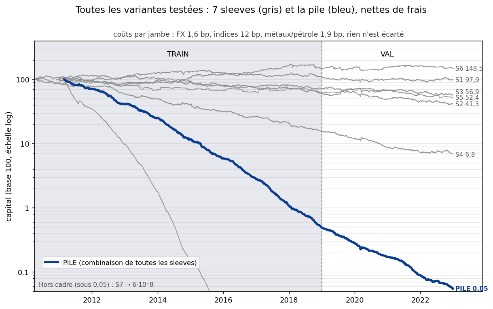

# Alpha pré-enregistré : peut-on empiler des stratégies simples jusqu'à un Sharpe net > 2 ?

Sept stratégies de la littérature aux paramètres figés avant le premier calcul, coûts réels par actif, exécution décalée, test final scellé : le verdict publié est un échec, avec toutes les courbes et tous les chiffres.

> **At a glance (EN).** Seven literature strategies run under a frozen protocol (SHA-256 of the original file published and checked by a test), real per-asset costs, delayed execution and a sealed final test. Verdict: failure; the stack's validation Sharpe is −5.30 net and −0.70 gross.
> **Caveat:** the validation period (2019-2022) had already been seen in an earlier research project, so only the sealed test period (2023+, never read) is untouched. A positive control (simulated edge, same statistics) shows the pipeline would detect a real edge.
> Python 3.12, numpy / pandas / scipy; every figure is regenerated from `results/` by scripts and checked by tests and CI.

[](https://github.com/yassine-ek/preregistered-alpha-research/actions/workflows/tests.yml)   [](https://yassine-ek.github.io/preregistered-alpha-research/)

## Résultats clés

<!-- AUTO:CLES -->
- **Verdict : échec, et d'abord un manque d'edge brut.** Pile des 7 sleeves en VAL : Sharpe net **−5,30** (IC 95 % [−6,31 ; −4,30]), Sharpe brut −0,70 ; aucune sleeve n'a un Sharpe brut VAL au-delà de 0,14. *Réserve : coûts = spreads publics de courtiers de détail (millésime récent appliqué à toute la période, indices à 12 bp), pas des coûts d'exécution mesurés ; S7 porte 75 % de la perte annuelle.*
- **Le test aurait détecté un vrai edge (contrôle positif, exploratoire).** Sur des sleeves simulées de la longueur de VAL, la gate G2 passe dans 60 % des cas à Sharpe vrai 1,0, 85 % à 1,5, 98 % à 2,0, et dans 3 % à Sharpe vrai 0. *Réserve : sur 4 ans un Sharpe vrai de 0,5 n'est détecté que dans 15 % des cas : les sleeves lentes (S1, S6) restent indiscernables de zéro, et d'un petit edge.*
- **VAL n'est pas vierge.** La période 2019-2022 et le même univers avaient déjà servi à au moins 134 essais lors d'un projet de recherche antérieur (non publié) ; seul TEST (2023+, scellé, jamais lu) est vierge. Protocole d'origine publié à l'octet près ([`PREREGISTRATION_v1.md`](PREREGISTRATION_v1.md), SHA-256 `f6007427…`, vérifié par un test), mais horodaté par un dépôt personnel, pas par un tiers ; le N = 8 du DSR est un plancher, pas un compte exact.
<!-- /AUTO:CLES -->



**Comment lire ce graphique.** Capital de la pile (les 7 sleeves, toutes gardées) en base 100, échelle logarithmique, **net de frais réels**. Zone grisée : TRAIN ; à droite de la ligne pointillée : VAL. Panneau du bas : drawdown de chaque période. Une courbe qui descend régulièrement des deux côtés n'est pas un overfit : c'est l'absence d'edge, aggravée par des coûts supérieurs au gain brut.

**Liens.** [Tableau de bord interactif](https://yassine-ek.github.io/preregistered-alpha-research/) · [Visite guidée (notebook)](notebooks/visite_guidee.ipynb) · [Résultats détaillés](docs/resultats_detailles.md) · [Approfondissement, sensibilité aux coûts, contrôle positif](docs/approfondissement.md) · [Protocole d'origine](PREREGISTRATION_v1.md) · [Verdict (JSON)](results/verdict_alpha.json)

## Frais et hypothèses

<!-- AUTO:FRAIS -->
| Hypothèse | Valeur |
|---|---|
| Coûts par jambe | FX : médiane 1,63 bp (48 actifs, 0,40 à 10,69) ; Indice : médiane 12,00 bp (7 actifs) ; Matière première / métal : médiane 1,91 bp (3 actifs, 0,73 à 2,53). Indices figés à 12 bp. Coût = bp × \|Δ position\| (ouvrir puis fermer = 2 jambes) |
| Source et limite | spreads publics de courtiers de détail (FBS, FTS Prime, IG, Pepperstone, Tickmill, Trading 212) dans [`data/frais_editable.csv`](data/frais_editable.csv), millésime récent appliqué à toute la période (plutôt flatteur pour 2010-2015) : ce ne sont pas des coûts d'exécution mesurés. Non modélisés : portage, financement, impact, compensation entre sleeves |
| Données | HistData 1 minute (BID) et barres 1 h dérivées ; 58 actifs (60 séries au pré-enregistrement, WTIUSD et GRXEUR exclus), non redistribuées (voir « Obtenir les données ») |
| Découpage | TRAIN 2010-2018 · VAL 2019-2022 (**déjà vue lors d'un projet antérieur**) · **TEST 2023+ scellé**, jamais lu (`scripts/ouvrir_test.py` jamais lancé) |
| Exécution et risque | quotidien : décision à 11h00, exécution le jour suivant, gain du jour suivant au surlendemain ; intrajournalier : entrée à l'open de la minute qui suit le signal. Chaque sleeve vise 10 % de volatilité annuelle (EWMA, passé seulement) |
| Gates (pré-enregistrées) | G1 Sharpe net VAL ≥ 1 : **−5,30** · G2 borne basse IC 95 % > 0 : **−6,31** · G3 (DSR) échoue, mais n'est pas informatif ici (voir « Pré-enregistrement ») |
<!-- /AUTO:FRAIS -->

## Métriques de la stratégie

<!-- AUTO:METRIQUES -->
**Pile des 7 sleeves (toutes gardées, nettes de frais)**

| Métrique | TRAIN | VAL |
|---|---|---|
| Sharpe net (annualisé, √252) | −6,48 | −5,30 |
| Sharpe brut (avant frais) | 0,01 | −0,70 |
| IC 95 % bootstrap du Sharpe net | [−7,39 ; −5,64] | [−6,31 ; −4,30] |
| Rendement annualisé net | −64,8 % | −52,4 % |
| Volatilité annualisée | 10,0 % | 9,9 % |
| Drawdown max | −99,5 % | −88,9 % |
| Calmar (rendement / drawdown max) | −0,65 | −0,59 |
| Nombre de trades (ordres exécutés) | 100 520 | 50 528 |
| Taux de gain (jours actifs gagnants) | 31,6 % | 35,8 % |
| Rotation annuelle (× le capital) | 1 375× | 1 349× |
| Coût annuel (% du capital) | 64,9 % | 45,5 % |
| Verdict | n/a | **ECHEC** (G1, G2, G3 en échec ; TEST scellé) |

**Chaque sleeve** (7 colonnes ; le détail complet est dans « Toutes les variantes » plus bas)

| Série | Sharpe net TRAIN | Sharpe net VAL | Sharpe brut VAL | Rend. net/an VAL | Drawdown VAL | Coût/an VAL |
|---|---|---|---|---|---|---|
| S1 Trend following | 0,16 | −0,20 | −0,12 | −2,2 % | −19 % | 0,9 % |
| S2 Momentum devises | −0,46 | −0,82 | −0,71 | −8,9 % | −39 % | 1,2 % |
| S3 Retournement devises | −0,31 | −0,49 | −0,15 | −5,0 % | −26 % | 3,5 % |
| S4 Saisonnalité FX | −1,91 | −1,81 | 0,14 | −19,0 % | −56 % | 20,5 % |
| S5 Fixing fin de mois | −0,47 | −0,49 | −0,15 | −4,1 % | −28 % | 2,9 % |
| S6 Actions vol-gérées | 0,52 | 0,07 | 0,12 | 0,7 % | −15 % | 0,6 % |
| S7 Momentum SPX intraj. | −15,60 | −12,34 | −1,29 | ruine (< −100 %) | −100 % | 121,2 % |
| **PILE (7 sleeves)** | −6,48 | −5,30 | −0,70 | −52,4 % | −89 % | 45,5 % |

*Rendement annuel = moyenne quotidienne × 252 (arithmétique), affiché « ruine » s'il est inférieur à −100 % : S7 est une sleeve intrajournalière (30 minutes d'exposition par jour) dont la volatilité cible de 10 % impose un fort levier ; les coûts qui en découlent (121 % du capital par an en VAL, 191 % en TRAIN) dépassent tout le capital. La série continue après la ruine (rien n'est liquidé) ; le chiffre exact est dans `results/train_val.json`.*
<!-- /AUTO:METRIQUES -->

## Overfit ou pas ? Lecture en 30 secondes

<!-- AUTO:OVERFIT -->
1. **Rapport Sharpe VAL / TRAIN de la pile : −5,30 / −6,48 = 0,82, mais les deux sont négatifs.** Il n'y a pas de performance qui s'effondre hors échantillon : il n'y en avait pas non plus dans l'échantillon. Seules les sleeves à Sharpe TRAIN positif seraient candidates à un overfit : S1 0,16 → −0,20 (rapport −1,25), S6 0,52 → 0,07 (rapport 0,13) ; elles se dégradent, ce qui est compatible avec du bruit (S6 est surtout du bêta actions).
2. **L'IC 95 % du Sharpe net VAL de la pile est [−6,31 ; −4,30]** : borne basse −6,31, G2 en échec. Puissance : 4 ans de VAL ne détectent avec 80 % de chances qu'un Sharpe vrai d'au moins 1,22. Verdict `ECHEC`, TEST non ouvert.
3. **Fixé avant de calculer la pile : tout.** Les 7 sleeves et leurs paramètres, les poids (∝ 1/vol TRAIN), la vol cible, les coûts, les gates et le nombre d'essais sont dans [`PREREGISTRATION_v1.md`](PREREGISTRATION_v1.md) ; aucune sélection par la performance, aucune sleeve retirée après coup (même la pire, S7). La seule modification venue après la lecture de VAL (horloge HistData, avenant 1) est déclarée. **Mais VAL n'est pas hors échantillon au sens strict** : voir « Pré-enregistrement ».
<!-- /AUTO:OVERFIT -->



**Comment lire ce graphique.** Un point par variante : Sharpe net TRAIN en abscisse, VAL en ordonnée (échelle symlog : linéaire entre −1 et 1, logarithmique au-delà). Sur la diagonale, VAL = TRAIN. Un overfit se reconnaît à des points en bas à droite (beau en TRAIN, mauvais en VAL) ; ici presque tous sont en bas à gauche, sur la diagonale : mauvais aux deux endroits.

## Toutes les variantes

Rien n'est caché : les 7 sleeves et la pile, TRAIN et VAL, **y compris les échecs**. Il n'y a pas de grille de paramètres (le protocole l'interdit) : une variante est une sleeve pré-enregistrée, et la pile garde toutes les sleeves.



**Comment lire ce graphique.** Chaque ligne grise est l'equity nette d'une sleeve (base 100, échelle logarithmique), la ligne bleue est la pile. La plupart des sleeves dérivent vers le bas dans les deux périodes, S7 sort du cadre par le bas (valeur finale écrite sur le graphique) ; seules S6 et S1 restent proches de 100. La pile suit les plus mauvaises, car ses poids (∝ 1/vol TRAIN) ne regardent jamais un Sharpe.

<details>
<summary>Tableaux complets : performance, activité, coûts (11 colonnes)</summary>

<!-- AUTO:VARIANTES -->
**Performance**

| Variante | Sharpe net TRAIN | Sharpe net VAL | Sharpe brut TRAIN | Sharpe brut VAL | Rend. net/an TRAIN | Rend. net/an VAL | Vol TRAIN | Vol VAL | Drawdown TRAIN | Drawdown VAL |
|---|---|---|---|---|---|---|---|---|---|---|
| S1 Trend following | 0,16 | −0,20 | 0,23 | −0,12 | 1,7 % | −2,2 % | 10,8 % | 11,0 % | −30 % | −19 % |
| S2 Momentum devises | −0,46 | −0,82 | −0,35 | −0,71 | −4,9 % | −8,9 % | 10,6 % | 10,9 % | −40 % | −39 % |
| S3 Retournement devises | −0,31 | −0,49 | −0,02 | −0,15 | −3,2 % | −5,0 % | 10,2 % | 10,2 % | −40 % | −26 % |
| S4 Saisonnalité FX | −1,91 | −1,81 | −0,24 | 0,14 | −20,1 % | −19,0 % | 10,5 % | 10,5 % | −86 % | −56 % |
| S5 Fixing fin de mois | −0,47 | −0,49 | −0,19 | −0,15 | −5,0 % | −4,1 % | 10,5 % | 8,3 % | −37 % | −28 % |
| S6 Actions vol-gérées | 0,52 | 0,07 | 0,56 | 0,12 | 5,2 % | 0,7 % | 10,0 % | 10,1 % | −17 % | −15 % |
| S7 Momentum SPX intraj. | −15,60 | −12,34 | 0,03 | −1,29 | ruine (< −100 %) | ruine (< −100 %) | 12,2 % | 10,9 % | −100 % | −100 % |
| **PILE (7 sleeves)** | −6,48 | −5,30 | 0,01 | −0,70 | −64,8 % | −52,4 % | 10,0 % | 9,9 % | −100 % | −89 % |

**Activité, coûts et significativité**

| Variante | Calmar TRAIN | Calmar VAL | Trades TRAIN | Trades VAL | Taux de gain TRAIN | Taux de gain VAL | Rotation/an VAL | Coût/an TRAIN | Coût/an VAL | PSR(0) VAL |
|---|---|---|---|---|---|---|---|---|---|---|
| S1 Trend following | 0,06 | −0,12 | 61 250 | 32 332 | 51,3 % | 51,3 % | 34× | 0,7 % | 0,9 % | 0,341 |
| S2 Momentum devises | −0,12 | −0,23 | 3 275 | 1 476 | 50,0 % | 48,6 % | 94× | 1,2 % | 1,2 % | 0,049 |
| S3 Retournement devises | −0,08 | −0,20 | 3 635 | 1 648 | 48,8 % | 48,6 % | 268× | 3,0 % | 3,5 % | 0,158 |
| S4 Saisonnalité FX | −0,23 | −0,34 | 27 200 | 12 444 | 44,2 % | 44,0 % | 2 221× | 17,6 % | 20,5 % | 0,000 |
| S5 Fixing fin de mois | −0,14 | −0,15 | 784 | 366 | 42,9 % | 37,0 % | 474× | 3,0 % | 2,9 % | 0,159 |
| S6 Actions vol-gérées | 0,31 | 0,04 | 654 | 336 | 53,8 % | 54,9 % | 5× | 0,5 % | 0,6 % | 0,553 |
| S7 Momentum SPX intraj. | −1,91 | −1,35 | 3 722 | 1 926 | 8,7 % | 14,1 % | 1 010× | 191,3 % | 121,2 % | 0,000 |
| **PILE (7 sleeves)** | −0,65 | −0,59 | 100 520 | 50 528 | 31,6 % | 35,8 % | 1 349× | 64,9 % | 45,5 % | 0,000 |

*Nombre de trades = ordres exécutés (quotidien : variations de position non nulles par actif ; intrajournalier : 2 ordres par position). TRAIN d'une sleeve = depuis son premier jour actif. « ruine » : rendement annuel inférieur à −100 % (voir la note sous les métriques).*
<!-- /AUTO:VARIANTES -->

</details>

## Pré-enregistrement : ce qui est vérifiable, et ce qui ne l'est pas

- **Protocole d'origine, vérifiable.** [`PREREGISTRATION_v1.md`](PREREGISTRATION_v1.md) est le protocole tel qu'il a été figé, publié à l'octet près. `sha256sum PREREGISTRATION_v1.md` (ou `python scripts/verifier_prereg.py`) donne `f6007427c1a455525c3e863e680e02aac4775e432783abc1ea6247b656182250` ; le test `tests/test_verifier_prereg.py` le contrôle à chaque CI, avec fins de ligne normalisées (un clone Windows donne la même empreinte).
- **Fichier courant.** [`PREREGISTRATION.md`](PREREGISTRATION.md) = la v1 dont la ligne `(aucun)` est remplacée par les avenants, sans autre modification (le script le vérifie octet par octet). `scripts/ouvrir_test.py` compare lui aussi l'empreinte de la v1 avant d'ouvrir le TEST ; il n'a jamais été lancé.
- **Avenant 1** (écrit après la lecture de VAL, signalé comme tel) : l'horloge des minutes HistData suit l'heure d'été, ce n'est pas de l'EST fixe. Aucun paramètre n'a changé ; effet : Sharpe brut VAL de S4 0,58 → 0,14, pile −5,32 → −5,30, verdict inchangé.
- **Avenant 2** (14/10/2026) : les heures écrites dans le texte (« vers 01h15 », « ~04h00 ») étaient des estimations erronées. Les horodatages des commits d'origine font foi : protocole commité le 13/10/2026 à 00:43 (+02:00), avant le premier fichier de code ; avenant 1 à 01:51.
- **Limite : l'horodatage n'est pas certifié par un tiers.** Il repose sur un dépôt git personnel, dont l'historique d'origine n'est pas publié ici (d'où la copie de la v1 à l'octet près). Aucun ancrage externe (OpenTimestamps, tag signé) n'a été fait.
- **Limite : VAL n'est pas vierge.** La période 2019-2022 et le même univers avaient déjà servi, dans un projet de recherche antérieur sur d'autres stratégies (non publié), à au moins 134 essais (plancher déclaré, pas un plafond). Le N = 8 du DSR est un plancher ; seul TEST (2023+) est vierge, et il reste scellé.
- **La gate G3 (DSR) ne discrimine rien ici.** Le Sharpe de la pile est négatif, donc PSR(0) = 0 et DSR = 0 quel que soit N ; et le seuil SR0 = 6,23 est gonflé par la variance des 8 Sharpe (tirée par S7 à −12), alors que le seuil théorique serait 0,72. La gate est conservée telle que pré-enregistrée ; le verdict repose sur G1 et G2.

## Contrôle positif : le test aurait-il vu un vrai edge ?

*Exploratoire, non pré-enregistré, hors verdict.* Un test qui répond toujours « pas d'edge » ne prouve rien : on injecte donc un edge connu dans les mêmes statistiques.

<!-- AUTO:CONTROLE -->
Une sleeve simulée de **Sharpe vrai 1,0** (rendements gaussiens, vol 10 %, graine fixe 20261014, déclarée avant de regarder le résultat) plus 7 sleeves nulles (N = 8 essais, comme le protocole) traverse les mêmes fonctions que les sleeves réelles. Sur VAL : Sharpe estimé **1,03**, IC 95 % [0,05 ; 2,07] ; G1 passe, G2 passe, G3 échoue (DSR 0,52). Part de 300 simulations de 1044 jours (= VAL) où chaque gate passe :

| Sharpe vrai | Sharpe estimé moyen | G1 passe | G2 passe | G3 passe | IC 95 % contient le vrai Sharpe |
|---|---|---|---|---|---|
| 0,0 | −0,01 | 2 % | 3 % | 0 % | 96 % |
| 0,5 | 0,45 | 10 % | 15 % | 0 % | 95 % |
| 1,0 | 1,07 | 59 % | 60 % | 2 % | 93 % |
| 1,5 | 1,48 | 82 % | 85 % | 17 % | 92 % |
| 2,0 | 2,05 | 98 % | 98 % | 51 % | 94 % |

*Lecture : le pipeline ne crie pas à l'edge dans le bruit (3 % de faux positifs à Sharpe vrai 0, couverture de l'IC proche de 95 %) et retrouve un edge fort (98 % à Sharpe vrai 2,0). Il manque de puissance pour un edge faible (Sharpe vrai 0,5 : 15 %), et la gate G3 (DSR, N = 8) est très conservatrice. Exploratoire, hors verdict.*
<!-- /AUTO:CONTROLE -->


**Comment lire ce graphique.** À gauche, la sleeve simulée (Sharpe vrai 1,0) sur le calendrier réel. À droite, pour chaque Sharpe vrai, la part des simulations où chaque gate passe : au Sharpe vrai 0 on lit le taux de faux positifs, plus à droite la puissance. Détail et code : [`docs/approfondissement.md`](docs/approfondissement.md), `scripts/run_controle_positif.py`, `results/controle_positif.json`.

## Tableau de bord interactif

Choisissez les conditions de départ (nombre de trades minimum, jours actifs, Sharpe TRAIN minimum, drawdown TRAIN maximum, fréquence, classe d'actifs) : seules les sleeves qui passent ces filtres sur **TRAIN** sont combinées (moyenne équipondérée), et la courbe obtenue est affichée sur TRAIN puis VAL avec ses métriques recalculées. Essai instructif : « Sharpe TRAIN min » à 0 ne laisse que S1 et S6, dont la combinaison paraît correcte en TRAIN puis recule en VAL : l'overfit à l'œil.

- En ligne : <https://yassine-ek.github.io/preregistered-alpha-research/>
- Ou ouvrir `docs/index.html` localement (données dans `docs/data.js`, aucun serveur nécessaire).
- Régénérer : `python scripts/exporter_dashboard.py` (lit `results/`, aucune donnée de marché requise). La sélection n'utilise que TRAIN ; le TEST n'apparaît jamais.

## Ce que ce projet démontre

Une démarche de recherche d'alpha où l'on peut vérifier ce qui est vrai derrière un backtest : coûts réels par actif, exécution décalée, paramètres fixés avant le résultat, nombre d'essais déclaré, intervalles de confiance, test final scellé, contrôle positif. Métiers visés : market making, exécution, plateformes de trading FX. Le résultat négatif est publié sans maquillage ; il montre aussi que des coûts d'exécution plus bas rendent *testables* des signaux rapides (voir la sensibilité aux coûts) sans créer d'edge.

<details>
<summary>La question et la méthode : protocole, les 7 sleeves, formules</summary>

**La question.** Peut-on atteindre un **Sharpe net > 2 hors échantillon** en empilant 7 stratégies simples tirées de la littérature, aux **paramètres fixés d'avance**, sur 58 actifs liquides FX / indices / métaux / pétrole aux coûts réels, **sans aucune sélection par la performance passée** ? L'attente écrite avant tout calcul était honnête : probablement non (sous indépendance il faut environ 16 sleeves de Sharpe 0,5 pour atteindre 2). Le livrable est la **mesure**.

- **Données** : barres 1 h pour les sleeves quotidiennes (instantané de 11h00 de l'horloge des fichiers, fixing retenu lors d'une exploration antérieure) ; minutes HistData pour les sleeves intrajournalières (l'horloge des fichiers suit l'heure d'été, ce n'est PAS de l'EST fixe : voir avenant 1). Actifs morts exclus.
- **Coûts réels** par jambe depuis [`data/frais_editable.csv`](data/frais_editable.csv) (indices à 12 bps). Coût = bps × |Δ position| ; une ouverture puis une fermeture = deux jambes.
- **Exécution décalée** : quotidien, décision à l'instantané J, exécution à J+1, gain J+1 → J+2 (un jour plein, plus strict que T+1 min) ; intrajournalier, entrée à l'open de la minute qui suit le signal, sortie à l'open de la minute qui suit la fin de fenêtre.
- **Découpage** : TRAIN 2010-2018 (préchauffage, calibration des échelles), VAL 2019-2022 (évaluation), TEST 2023+ **scellé**. **Vol cible** : 10 % par sleeve (covariance EWMA, demi-vie 36 jours, passé seulement).
- **Pile** : les 7 sleeves toutes gardées, poids ∝ 1 / vol réalisée sur TRAIN, puis échelle unique à 10 % de vol sur TRAIN. Aucun poids ne dépend d'un Sharpe.
- **Statistiques** : IC 95 % du Sharpe par bootstrap stationnaire (blocs moyens de 20 jours, 5 000 tirages), t de Newey-West + correction de Holm sur les 7 sleeves, PSR(0) et DSR (N = 8).
- **Gates sur la pile** : G1 Sharpe net VAL ≥ 1 ; G2 borne basse de l'IC > 0 ; G3 DSR ≥ 0,95 ; G4 TEST (lecture unique) Sharpe > 0 et ≥ 0,5 × Sharpe VAL. Objectif non bloquant : Sharpe ≥ 2.

| # | Sleeve | Source | Règle figée (résumé) |
|---|---|---|---|
| S1 | Trend following EWMAC | Carver 2015, Moskowitz-Ooi-Pedersen 2012 | 3 vitesses (16,64), (32,128), (64,256), prévision normalisée, tampon 10 %, 58 actifs |
| S2 | Momentum cross-sectionnel devises | Menkhoff et al. 2012 | rendement 63 j, long 3 / short 3, vendredi |
| S3 | Retournement court terme devises | littérature reversal FX | rendement 5 j, long les 3 pires, vendredi |
| S4 | Saisonnalité intrajournalière | Breedon-Ranaldo 2013 | vendre la devise étrangère pendant sa session (Londres 08h-14h, Tokyo 09h-15h) |
| S5 | Fixing de fin de mois | Melvin-Prins 2015 | dernier jour ouvré, 06h→10h, sens selon la surperformance SPX vs indice étranger |
| S6 | Actions gérées par la vol | Moreira-Muir 2017 | 7 indices, long seul, poids = c / variance du mois précédent, levier ≤ 2 |
| S7 | Momentum intrajournalier SPX | Gao-Han-Li-Zhou 2018 | signal veille 16h→10h ET, entrée 15h30, sortie 16h00 ET |

Les interprétations prises quand une règle était ambiguë (toujours dans le sens le plus conservateur) sont dans [`results/notes_implementation.md`](results/notes_implementation.md).

- **Sharpe annualisé** : `SR = moyenne(r_j) / écart-type(r_j) × √252` sur les rendements quotidiens **nets de frais**. Sur 4 ans l'erreur-type est d'environ 0,5 : un Sharpe de 0,5 n'est pas distinguable de zéro, d'où les intervalles de confiance.
- **Coût** : `coût_t = Σ_actifs bps_actif × 10⁻⁴ × |Δ position_actif,t|` ; `rendement net = rendement brut − coût`.
- **PSR et DSR** (Bailey et López de Prado) : `PSR(SR*) = Φ( (SR − SR*)·√(n−1) / √(1 − γ₃·SR + (γ₄−1)/4·SR²) )` ; le DSR est le PSR contre le meilleur Sharpe qu'on obtiendrait par hasard en testant N stratégies.
- **Diversification** : pour N sleeves de même Sharpe `s` et de corrélation moyenne `ρ`, `SR_pile = s·√N / √(1 + (N−1)·ρ)` : elle multiplie un Sharpe existant, elle n'en crée pas.

</details>

## Lecture honnête

- **Une sleeve écrase tout** : S7 (momentum intrajournalier SPX) a un gain brut moyen par trade nul ou négatif (≈ 0 bp en TRAIN, −1,9 bp en VAL) face à 2 × 12 bps de coût, multipliés par le levier d'une vol cible de 10 % sur une demi-heure d'exposition. Elle teste surtout le spread du courtier, pas l'anomalie publiée. Retirer S7 « pour voir » est ce que le protocole interdit (nouvelle idée = nouveau pré-enregistrement).
- **S4 : un signal brut quasi nul que les coûts transforment en perte nette** : Sharpe brut VAL 0,14 (non distinguable de zéro), net −1,81 ; le gain brut par trade est inférieur au coût aller-retour sur les 6 paires.
- **Les sleeves quotidiennes (S1, S2, S3, S6) sont indiscernables de zéro ou négatives en VAL** : aucune ne passe Holm. S2 est négative aussi en TRAIN ; une vérification indépendante (spread hebdomadaire équipondéré, sans le moteur du dépôt) donne le même signe.
- **Corrélations faibles, sauf S1-S2** (0,58 en VAL) : l'idée « sleeves décorrélées » tient, mais décorréler des sleeves sans edge ne produit pas d'edge. Il faudrait 0,81 de Sharpe net par sleeve avec 7 sleeves ; le meilleur Sharpe net VAL est 0,07.
- **Biais corrigés par construction** : aucun fill au prix du signal, coûts réels dès le premier calcul, pas de sélection, Sharpe toujours accompagné d'un IC bootstrap, test de causalité de bout en bout (ajouter du futur ne change aucun rendement passé, à égalité exacte).

Tableaux complets, gates, poids de la pile et figures : [`docs/resultats_detailles.md`](docs/resultats_detailles.md).

## Approfondissement et sensibilité aux coûts (exploratoire)

Analyses a posteriori sur TRAIN et VAL, non pré-enregistrées, qui ne modifient pas le verdict ([`docs/approfondissement.md`](docs/approfondissement.md), carnet [`notebooks/approfondissement.ipynb`](notebooks/approfondissement.ipynb)) :

- **Sensibilité aux coûts** : même à coût nul, aucune sleeve n'atteint un Sharpe brut VAL de 0,15 et la pile reste à −0,75 : le goulot est l'edge brut, pas seulement les coûts. Une exécution moins chère rend testables les sleeves rapides (S3, S4, S5) mais ne crée pas d'edge.
- **Loi fondamentale (Q1)** : pour un IR de 2 avec ~1 792 paris indépendants par an, il faudrait un IC de 0,059 sur chaque sleeve ; observé −0,047. Ce qui manque est de l'IC, pas de la breadth.
- **Puissance (Q3)** : 4 ans de VAL ne détectent qu'un Sharpe vrai ≥ 1,22 ; confirmer un Sharpe de 0,5 prend 25 ans.
- **Tests multiples (Q4)** : sur la durée de VAL, le hasard fabrique un Sharpe de 1 après 28 essais et de 2 après 24 121.
- **Anatomie de l'échec (Q5), diversification (Q6), capacité (Q7)** : le goulot est l'edge brut, ni les coûts, ni la capacité, ni le régime.

## Validation et tests

`python -m pytest -q` ; les tests qui lisent les données locales sont sautés proprement (« skipped ») si `HISTDATA_DIR` n'est pas défini, ce qui est le cas en intégration continue. Chaque brique est confrontée à une réponse connue (simulation, formule fermée, signal planté) ; les garanties de causalité et de non-ouverture du TEST sont des tests, pas des promesses.

| Fichier | Ce qui est vérifié |
|---|---|
| [`test_anti_look_ahead.py`](tests/test_anti_look_ahead.py) | Modifier les données FUTURES ne change aucun poids PASSÉ, pour chacune des 7 sleeves. |
| [`test_approfondissement_*.py`](tests/) (4 fichiers) | Approfondissement : formules (Sharpe max attendu, erreur-type de Lo, puissance, diversification, loi fondamentale) confrontées à des simulations ; IC sans look-ahead ; lecteur 1 h strict ; verdict `ECHEC` inchangé ; empreinte du code officiel. |
| [`test_causalite_bout_en_bout.py`](tests/test_causalite_bout_en_bout.py) | Même propriété de bout en bout sur données réelles (données locales requises). |
| [`test_controle_positif.py`](tests/test_controle_positif.py) | Contrôle positif : la simulation a le Sharpe vrai demandé, la graine est fixe, le pipeline détecte un edge fort et pas le bruit, le résultat versionné se recalcule à l'identique. |
| [`test_couts_moteur.py`](tests/test_couts_moteur.py) | Coûts nuls = rendement brut ; chronologie exacte de l'exécution décalée ; coûts lus dans `data/frais_editable.csv` ; garde-fou d'ouverture du TEST ; verdict selon le §8 du protocole. |
| [`test_dashboard_et_readme.py`](tests/test_dashboard_et_readme.py) | Tableau de bord (`docs/data.json` cohérent avec `results/`, sans TEST) ; blocs de chiffres des documents lus dans `results/`. |
| [`test_hygiene_depot.py`](tests/test_hygiene_depot.py) | Aucun chemin absolu de machine ni trace interne dans les fichiers suivis (le test ignore `.venv`, caches et `build`) ; `.gitattributes` présent. |
| [`test_horloge_donnees.py`](tests/test_horloge_donnees.py) | Horloge réelle des minutes HistData (heure d'été) : ouverture hebdomadaire EURUSD prédite à plus de 98 % (cache des minutes requis). |
| [`test_sleeves_structure.py`](tests/test_sleeves_structure.py), [`test_stats.py`](tests/test_stats.py) | Structure des sleeves (long 3 / short 3 somme nulle, vol cible ex ante, tampon de S1) ; statistiques sur données simulées de réponse connue (bootstrap, Newey-West, Holm, PSR, DSR, drawdown). |
| [`test_troncature_test.py`](tests/test_troncature_test.py) | Le TEST (≥ 2023-01-01) est inaccessible depuis les chemins train/val : refus, troncature, aucune année 2023 demandée au disque. |
| [`test_verifier_prereg.py`](tests/test_verifier_prereg.py) | Empreinte de `PREREGISTRATION_v1.md`, fichier courant = v1 + avenants, fins de ligne normalisées, modifications détectées, garde-fou de `ouvrir_test.py`. |

Garde-fous du TEST : (1) `alpha/donnees.py` lève `PermissionError` si on demande une date ≥ 2023-01-01 sans l'autorisation explicite que seul `scripts/ouvrir_test.py` donne ; (2) `ouvrir_test.py` refuse de tourner si G1 ou G2 échoue (c'est le cas) ou si l'empreinte de la v1 a changé ; (3) l'empreinte SHA-256 du code officiel est enregistrée dans `results/empreinte_code.json`.

## Limites

- **VAL court et déjà vu** : 4 ans (1 044 jours), erreur-type du Sharpe d'environ 0,5 ; rien ici ne permet de dire qu'un Sharpe de 0,3 est vrai ou faux. VAL a servi à un projet antérieur (voir « Pré-enregistrement »).
- **TEST jamais lu** : la conclusion `ECHEC` s'appuie sur G1 et G2 en VAL ; un TEST ne pourrait pas rattraper une pile à Sharpe net −5,3.
- **Coûts de détail, constants sur toute la période** : spreads publics de courtiers (millésime récent), pas des coûts d'exécution mesurés ; plutôt flatteurs pour 2010-2015.
- **Pas de portage ni de financement**, pas de compensation d'ordres entre sleeves (S1 long EURUSD et S4 short EURUSD paient chacun leurs coûts : prudent), pas de modèle de glissement ou d'impact.
- **Pas d'audit de qualité croisé** des minutes contre une seconde source de données.
- **Calibration de S6 sur TRAIN** : la constante `c` est choisie pour que la vol TRAIN soit 10 % (prévu par le protocole). **Minutes HistData** : BID seulement, trous de 5 minutes tolérés au plus.
- **Pas de benchmark externe** (indice CTA, buy-and-hold) : S6 est surtout du bêta actions (corrélation 0,76 au facteur indices).

## Comment ce projet a été construit

Projet réalisé en octobre 2026 avec un assistant de programmation IA (Claude, Anthropic) que j'ai dirigé : choix des sujets, protocole, vérification des résultats. Tous les chiffres sont régénérés par les scripts du dépôt et contrôlés par les tests et la CI.

## Obtenir les données

Les données de marché ne sont pas redistribuées. Sans elles, on relit tous les chiffres dans `results/` et on régénère tout le reste (tests, tableau de bord, figures, blocs de chiffres, contrôle positif) ; seul le rejeu du calcul demande les données.

1. Télécharger les minutes (BID, ASCII, M1, une archive par actif et par année) sur <https://www.histdata.com>.
2. Les ranger sous un dossier de votre choix, avec l'arborescence attendue :

   ```
   <HISTDATA_DIR>/histdata_raw/<ACTIF>/<ACTIF>_<année>.zip    minutes (ex. EURUSD/EURUSD_2019.zip)
   <HISTDATA_DIR>/processed/univers/<ACTIF>_1h.csv            barres 1 h dérivées (colonnes datetime = début de barre, close)
   ```
3. Indiquer le dossier : `export HISTDATA_DIR=/chemin/vers/donnees` (PowerShell : `$env:HISTDATA_DIR = "D:/donnees"`). Sans la variable, le défaut est `./data/histdata` (ignoré par git).

Les barres 1 h sont un jeu dérivé des minutes (étiquette = début de la barre, vérifiée contre les minutes) ; aucun script de construction n'est fourni (limite connue). Sans les données, les scripts de rejeu s'arrêtent avec un message guidé (`scripts/verifier_donnees.py`) au lieu d'une trace brute.

## Reproduire

```bash
pip install -r requirements.txt

# 1. Sans données de marché : tests, puis tout ce qui se régénère depuis results/
python -m pytest -q                        # les tests qui lisent les données sont sautés (« skipped »)
python scripts/verifier_prereg.py          # empreinte de PREREGISTRATION_v1.md, lien v1 -> fichier courant
python scripts/exporter_dashboard.py       # -> docs/data.json, docs/data.js
python scripts/generer_figures_vitrine.py  # -> figures/hero_equity.png, toutes_variantes.png, overfit_scatter.png
python scripts/run_controle_positif.py     # EXPLORATOIRE -> results/controle_positif.json + figures/controle_positif.png (~1 min)
python scripts/generer_readme_tete.py      # -> blocs de chiffres du README et de docs/*.md, lus dans results/

# 2. Avec les données locales (voir « Obtenir les données »)
python scripts/run_train_val.py            # TRAIN/VAL uniquement -> results/train_val.json + figures/
python scripts/verdict.py                  # -> results/verdict_alpha.json
python scripts/auditer_reproduction_trades_frais.py  # reproduction à 1e-9, nombre de trades, frais
python scripts/sensibilite_couts.py        # EXPLORATOIRE -> results/sensibilite_couts_exploratoire.json
python scripts/run_approfondissement.py    # EXPLORATOIRE -> results/approfondissement.json + figures/appro_*.png
python scripts/build_nb_visite_guidee.py       # (re)génère notebooks/visite_guidee.ipynb
python scripts/build_nb_approfondissement.py   # (re)génère notebooks/approfondissement.ipynb
python -m jupyter nbconvert --to notebook --execute --inplace notebooks/visite_guidee.ipynb   # idem pour approfondissement.ipynb
# scripts/ouvrir_test.py : NE PAS LANCER sauf décision explicite (refuse si G1 ou G2 échouent)
```

Le chemin cité dans `PREREGISTRATION.md` est celui de la machine d'origine : le fichier est figé et haché, il n'a pas été réécrit (le code publié lit les données via `HISTDATA_DIR`). Dépendances : Python 3.12+, numpy, pandas, scipy, matplotlib, pyarrow (cache parquet), pytest ; jupyter seulement pour exécuter les carnets.

## Structure du dépôt

```
.
├── README.md                    ce fichier : résultats clés, frais, métriques TRAIN | VAL, courbe finale, « overfit ou pas ? »
├── PREREGISTRATION_v1.md        protocole d'origine, à l'octet près (SHA-256 f6007427…)
├── PREREGISTRATION.md           = la v1 + avenants 1 et 2 ; ne jamais modifier le texte d'origine
├── LICENSE  requirements.txt  .gitignore  .gitattributes  .github/workflows/tests.yml
├── alpha/                       le moteur de recherche (données, coûts, risque, sleeves, moteur, stats, gates, pipeline, graphiques)
│   └── approfondissement/       analyse exploratoire a posteriori (théorie, diagnostics, figures, contrôle positif) ; hors empreinte du code officiel
├── scripts/                     calculs, vérification du pré-enregistrement, export du tableau de bord, figures, blocs de chiffres
├── tests/                       suite pytest (synthétique, sauf les tests qui lisent les données locales)
├── notebooks/                   visite guidée et approfondissement (carnets exécutés)
├── results/                     sorties figées (JSON, CSV des rendements quotidiens) dont sont tirés tous les chiffres
├── figures/                     images du README (héro, variantes, overfit, PnL, coûts, approfondissement, contrôle positif)
├── docs/                        tableau de bord interactif (GitHub Pages) + resultats_detailles.md + approfondissement.md
└── data/frais_editable.csv      coûts réels par actif (copie versionnée) ; les données de marché ne sont pas versionnées
```

Chaque dossier a son propre `README.md` (rôle et une ligne par fichier).
