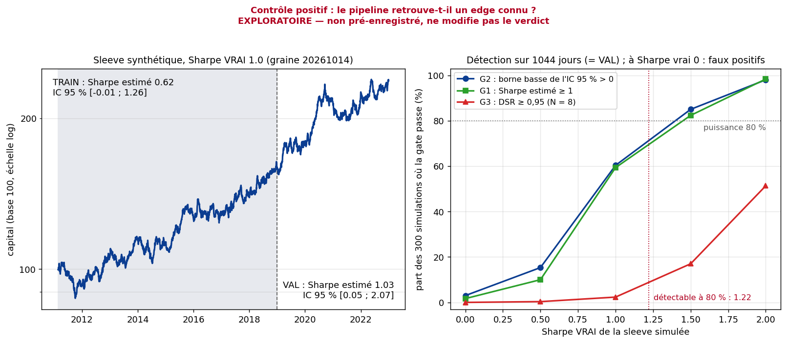
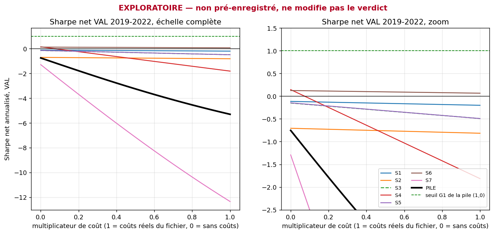
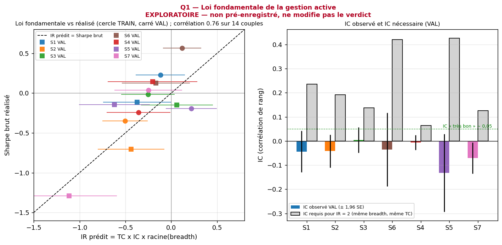
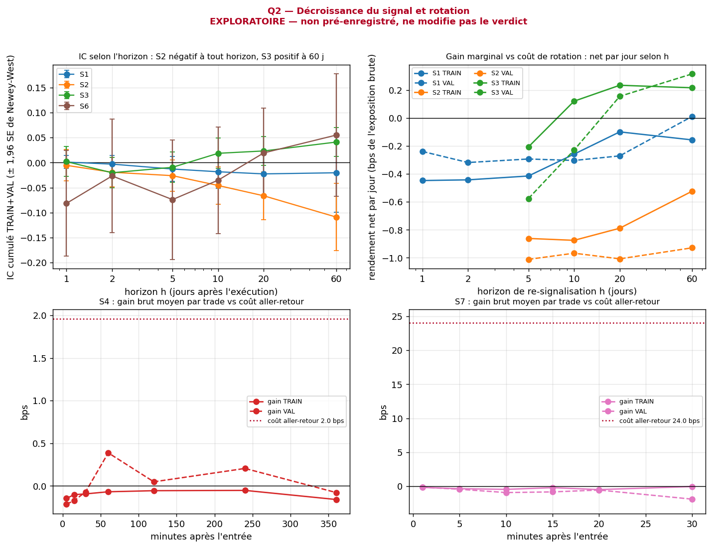
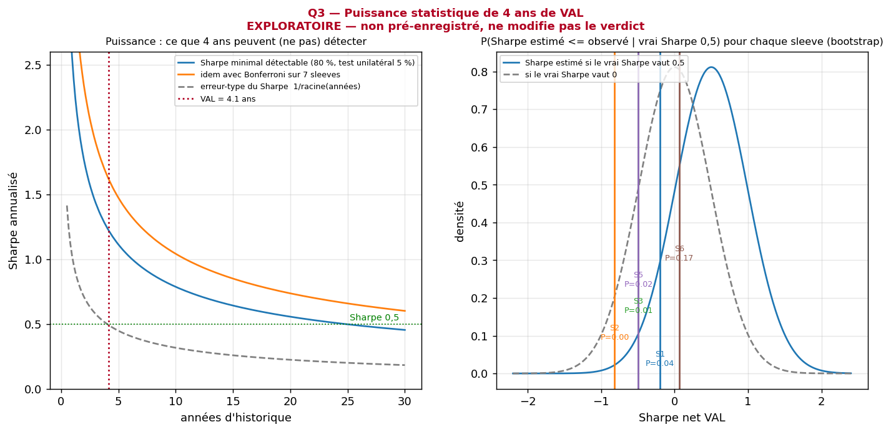
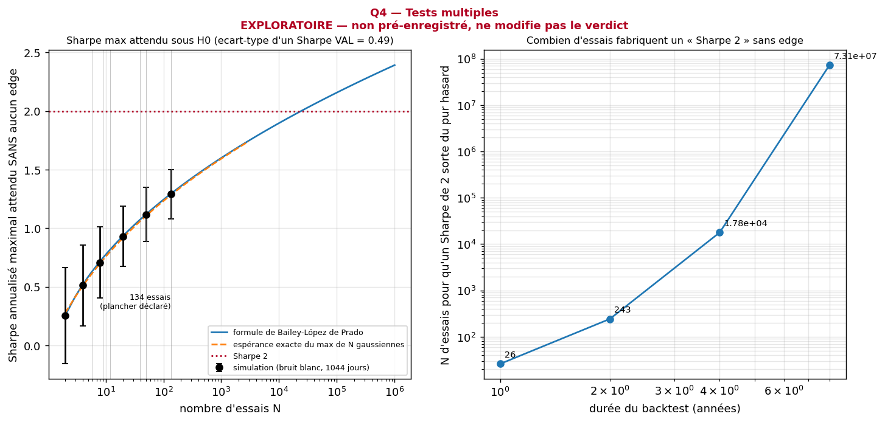
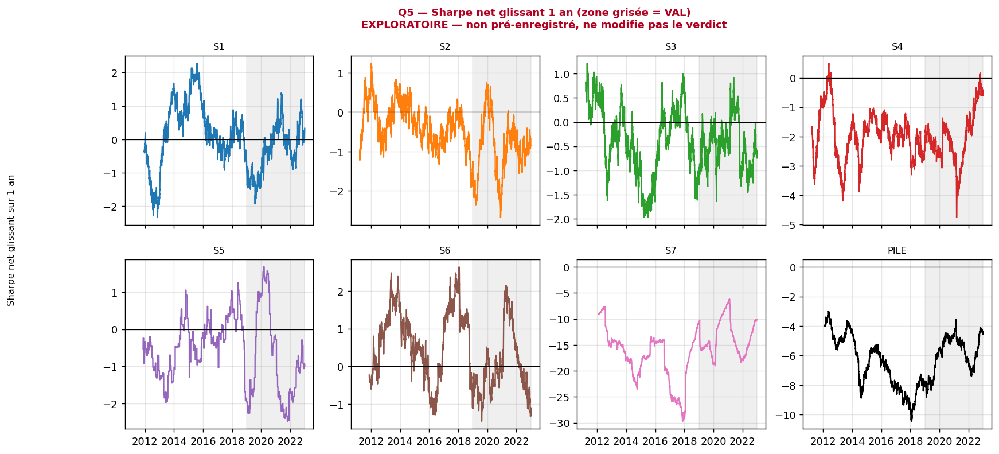
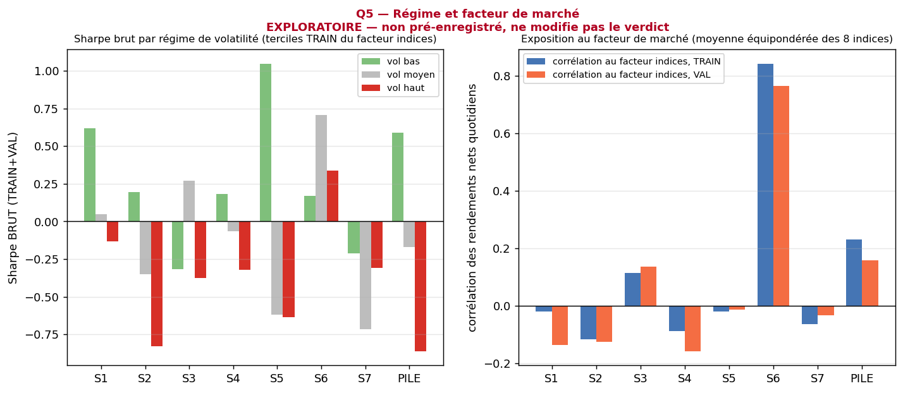
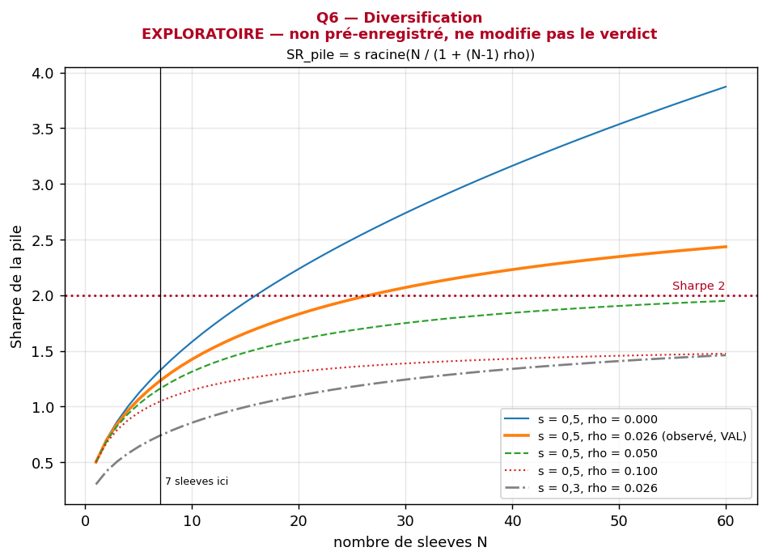
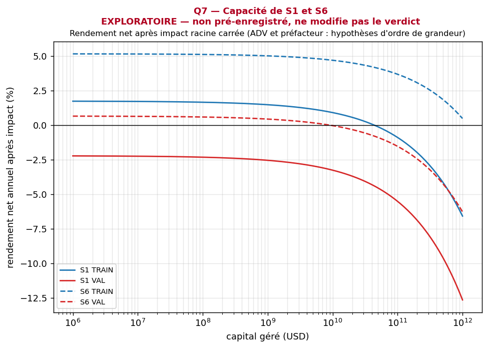

# Approfondissement, sensibilité aux coûts et contrôle positif (exploratoire)

> **EXPLORATOIRE, non pré-enregistré, ne modifie pas le verdict `ECHEC`.** Analyses a posteriori sur TRAIN (≤ 2018) et VAL (2019-2022) : le TEST reste scellé (lecteur 1 h strict qui s'arrête avant 2023, `scripts/ouvrir_test.py` jamais lancé), aucun paramètre des sleeves n'est touché, `PREREGISTRATION.md` n'est pas modifié (pas de nouvel avenant). VAL avait déjà été vue lors d'un projet de recherche antérieur (voir « Pré-enregistrement » dans le [README](../README.md)) : ces analyses ne sont donc pas hors échantillon, et leurs constats sont des hypothèses pour un NOUVEAU pré-enregistrement.
>
> Code : sous-paquet `alpha/approfondissement/` (hors de `alpha/*.py` pour que l'empreinte `code_sha256` du code officiel ne bouge pas) ; chiffres : [`results/approfondissement.json`](../results/approfondissement.json) ; carnet (un chapitre par question) : [`notebooks/approfondissement.ipynb`](../notebooks/approfondissement.ipynb).

## Contrôle positif : le pipeline retrouve-t-il un edge connu ?

Un test qui répond toujours « pas d'edge » ne prouve rien. On simule donc une sleeve **synthétique** dont le Sharpe vrai est connu (rendements gaussiens indépendants, volatilité annuelle 10 %, graine fixe `20261014` déclarée avant de regarder le résultat) et on la passe dans **exactement les mêmes fonctions** que les sleeves réelles : `pipeline.stats_periode` (Sharpe, IC 95 % par bootstrap stationnaire), `stats.newey_west`, `stats.psr`, `stats.dsr` (N = 8 essais : l'edge + 7 sleeves nulles, comme le protocole) et `gates.evaluer_gates_val`. Code : `alpha/approfondissement/signal_synthetique.py` ; script : `scripts/run_controle_positif.py` ; sortie : [`results/controle_positif.json`](../results/controle_positif.json) ; figure : [`figures/controle_positif.png`](../figures/controle_positif.png).

<!-- AUTO:CONTROLE_DETAIL -->
Sleeve synthétique de Sharpe vrai 1,0 (graine 20261014), calendrier réel de la pile (du 2018 au 2022), 7 sleeves nulles pour le DSR (SR0 annualisé 1,00) :

| Période | Sharpe estimé | IC 95 % bootstrap | t Newey-West | PSR(0) | DSR (N = 8) |
|---|---|---|---|---|---|
| TRAIN (2 048 jours) | 0,62 | [−0,01 ; 1,26] | n/d | n/d | n/d |
| VAL (1 044 jours) | 1,03 | [0,05 ; 2,07] | 1,99 | 0,982 | 0,523 |

Pour comparaison, la pile réelle a en VAL un Sharpe net de −5,30 (IC 95 % [−6,31 ; −4,30]). Sharpe minimal détectable à 80 % de puissance (test unilatéral 5 %, approfondissement Q3) : 1,22.
<!-- /AUTO:CONTROLE_DETAIL -->

Deux volets : l'illustration ci-dessus (une seule tirée, graine fixe) et l'étude de répétition du README (300 simulations de 1 044 jours par Sharpe vrai, 1 000 tirages de bootstrap par simulation au lieu de 5 000 pour limiter le temps de calcul, même procédure). Ce que cela montre, et ne montre pas :

- **Le pipeline n'est pas sourd.** À Sharpe vrai 2,0 la gate G2 passe dans presque tous les cas ; à Sharpe vrai 0 elle passe rarement (faux positifs de l'ordre de 2,5 %), et l'IC 95 % contient le vrai Sharpe dans environ 95 % des cas : le bootstrap stationnaire est bien calibré à cette longueur d'échantillon.
- **Il manque de puissance pour un edge faible.** Le Sharpe minimal détectable de 1,22 (test unilatéral 5 %, 80 % de puissance, Q3 ci-dessous) correspond à une puissance d'environ 70 % pour la gate G2, qui est plus stricte (borne basse d'un IC bilatéral 95 %) ; à Sharpe vrai 0,5 elle vaut environ 15 %.
- **La gate G3 (DSR, N = 8) est très conservatrice** : même un Sharpe vrai de 1,0 ne la franchit presque jamais sur 4 ans, parce que la variance des 8 Sharpe gonfle le seuil SR0. C'est une propriété du DSR à cette longueur d'échantillon, pas un défaut de la sleeve simulée.
- **Ce n'est pas une validation des sleeves réelles** : un edge simulé gaussien i.i.d. est plus facile à détecter qu'un edge réel (queues épaisses, autocorrélation, régimes). Le contrôle dit seulement que l'échec observé (Sharpe VAL −5,30, IC [−6,31 ; −4,30]) n'est pas imputable à une statistique aveugle : un Sharpe vrai ≥ 1 aurait été vu dans plus de la moitié des cas, et ce qui est observé est à plusieurs erreurs-types de zéro du mauvais côté.

**Comment lire ce graphique.** À gauche, la sleeve simulée (Sharpe vrai 1,0) sur le calendrier réel de la pile, TRAIN grisé. À droite, pour chaque Sharpe vrai, la part des simulations où G1, G2 et G3 passent ; la ligne rouge pointillée est le Sharpe minimal détectable de la question Q3.

## Sensibilité aux coûts

Sharpe net VAL 2019-2022 quand on multiplie les coûts réels du fichier par 0, 0,1, 0,25, 0,5 ou 1 (la pile est reconstruite à chaque fois par la procédure du protocole), et coût de rentabilité de chaque sleeve (coût par jambe qui annule son rendement net moyen VAL). Calculé par [`scripts/sensibilite_couts.py`](../scripts/sensibilite_couts.py), chiffres dans [`results/sensibilite_couts_exploratoire.json`](../results/sensibilite_couts_exploratoire.json), courbes dans [`figures/sensibilite_couts.png`](../figures/sensibilite_couts.png). TRAIN et VAL seulement, TEST jamais chargé.

<!-- AUTO:COUTS -->
| Série | ×0 (brut) | ×0,1 | ×0,25 | ×0,5 | ×1 (coûts réels) | Coût moyen actuel (bps/jambe) | Coût de rentabilité VAL (bps/jambe) |
|---|---|---|---|---|---|---|---|
| S1 Trend following | −0,12 | −0,12 | −0,14 | −0,16 | −0,20 | 2,81 | jamais (brut VAL ≤ 0) |
| S2 Momentum devises | −0,71 | −0,72 | −0,73 | −0,76 | −0,82 | 1,27 | jamais (brut VAL ≤ 0) |
| S3 Retournement devises | −0,15 | −0,19 | −0,24 | −0,32 | −0,49 | 1,30 | jamais (brut VAL ≤ 0) |
| S4 Saisonnalité FX | 0,14 | −0,05 | −0,35 | −0,84 | −1,81 | 0,92 | 0,07 |
| S5 Fixing fin de mois | −0,15 | −0,18 | −0,23 | −0,32 | −0,49 | 0,60 | jamais (brut VAL ≤ 0) |
| S6 Actions vol-gérées | 0,12 | 0,12 | 0,11 | 0,09 | 0,07 | 12,00 | 25,27 |
| S7 Momentum SPX intraj. | −1,29 | −2,50 | −4,28 | −7,15 | −12,34 | 12,00 | jamais (brut VAL ≤ 0) |
| **PILE (7 sleeves)** | −0,75 | −1,27 | −2,04 | −3,25 | −5,30 | 3,38 | jamais (brut VAL ≤ 0) |
<!-- /AUTO:COUTS -->

**Lecture.**

1. Même à coût nul, aucune sleeve n'atteint un Sharpe brut VAL de 0,15 et la pile reste à −0,75 : le goulot est d'abord l'edge brut, pas seulement les coûts. (La pile reconstruite à coût nul donne −0,75 contre −0,70 pour le Sharpe brut de la pile officielle : les poids sont recalculés à chaque multiple de coût.)
2. Les coûts ne décident que pour les sleeves rapides : S4 passe de −1,81 à −0,35 (×0,25) puis −0,05 (×0,1), mais son seuil de rentabilité (0,07 bp par jambe) est environ 14 fois sous le coût moyen du fichier (0,92 bp), pour un Sharpe brut de 0,14 non distinguable de zéro.
3. S6, lente (5× de rotation par an), reste rentable jusqu'à 25 bps par jambe (12 bps aujourd'hui) : des coûts institutionnels la changent à peine (0,07 → 0,12).
4. Pour un éditeur de plateformes FX dont les clients ont des coûts institutionnels (ici supposés entre ×0,1 et ×0,25 du fichier, hypothèse à confirmer), l'argument est le suivant : une exécution moins chère rend *testables* des sleeves à forte rotation (S3, S4, S5 remontent de −0,5 / −1,8 / −0,5 à environ −0,2 / −0,05 / −0,2 à ×0,1), mais elle ne crée pas d'edge : seul un signal brut positif devient exploitable, et aucune des 7 sleeves n'en montre un sur 2019-2022.

**Comment lire ce graphique.** Pour chaque série, le Sharpe net VAL quand on multiplie les coûts réels par 0, 0,1, 0,25, 0,5 ou 1 (la pile est reconstruite à chaque fois). Une courbe qui monte vite vers la gauche est sensible aux coûts (sleeves rapides) ; une courbe plate (S1, S6) ne l'est pas. Même à coût nul (point le plus à gauche), presque aucune courbe n'atteint un Sharpe positif : le goulot est l'edge brut.

## Les sept questions

### Q1. Combien d'IC, sur combien de paris, pour un IR de 2 ? (loi fondamentale de la gestion active)

IR ≈ TC × IC × √BR (Grinold ; Clarke-de Silva-Thorley). En VAL : TC moyen 0,94, breadth de la pile ≈ 1 792 paris indépendants/an (S4 988, S7 252, S3 277, S2 138, S1 91, S5 24, S6 23), IC par sleeve de −0,132 (S5) à +0,004 (S3).
La loi suit le Sharpe brut réalisé : corrélation 0,76 sur 14 couples (sleeve, période), écart prédit − réalisé |z| ≤ 1,1 (S7 VAL : IR prédit −1,11 pour −1,29 réalisé ; S2 VAL : −0,44 pour −0,71).
IC nécessaire pour un IR de 2 avec la breadth observée : 0,235 (S1), 0,192 (S2), 0,137 (S3), 0,064 (S4), 0,126 (S7) ; pour la pile, 0,059 sur **chaque** sleeve, contre un IC moyen observé de −0,047.
Avec l'IC de S3 (+0,004, le seul positif des sleeves quotidiennes) il faudrait 1 072 fois sa breadth. Ce qui manque est de l'IC, pas de la breadth.

**Comment lire ce graphique.** À gauche, le Sharpe brut réalisé en fonction de celui que prédit la loi fondamentale `IR ≈ TC × IC × √breadth` (cercles TRAIN, carrés VAL) : les points suivent la diagonale, donc la loi décrit bien ces sleeves. À droite, l'IC observé en VAL (barre colorée, avec ± 1,96 erreur-type) face à l'IC qu'il faudrait pour un IR de 2 (barre grise) : l'écart est dans l'IC, pas dans le nombre de paris.

### Q2. À quelle vitesse le signal s'éteint-il, et quel horizon le coût autorise-t-il ? (décroissance du signal)

IC de S2 (momentum 63 j) négatif à tous les horizons sur TRAIN+VAL (−0,006 à 1 j, −0,109 à 60 j, t de Newey-West −3,2) : le signal est inversé. IC de S3 (retournement 5 j) négatif à 2-5 j puis positif à 10-60 j (+0,041 à 60 j, t = 2,8), alors que S3 est tenue 5 jours :
re-signalisée tous les 60 j, la règle donnerait +0,22 bps/jour (TRAIN) et +0,32 bps/jour (VAL) nets de l'exposition brute. Constat **a posteriori** (6 horizons × 4 sleeves lus) : une piste pour un nouveau pré-enregistrement, pas un résultat.
Demi-vie du signal : S1 65 j, S2 30 j, S3 2 j, S6 58 j ; celle de l'IC n'est définie que pour 2 couples sur 8 (IC le plus souvent ≤ 0). Horizon optimal sous coût : 1 − (1+u)e^(−u) = C/A avec u = h/τ (gain marginal = rendement net moyen), vérifié contre une grille dans les tests.
Intrajournalier : gain brut maximal de S4 0,39 bps/trade pour 1,96 bps de coût aller-retour ; S7 jamais positif (au mieux −0,05 bps pour 24 bps).

**Comment lire ce graphique.** En haut à gauche, l'IC cumulé selon l'horizon h : au-dessus de zéro, le signal prédit encore ; au-dessous, il est inversé (S2). En haut à droite, le rendement net par jour selon l'horizon de re-signalisation : on cherche le sommet, qui dit combien de temps tenir une position avant que les coûts n'écrasent le gain. Les panneaux du bas comparent, pour S4 et S7, le gain brut par trade (courbes) au coût aller-retour (pointillé rouge).

### Q3. Que peut-on conclure de 4 ans de VAL ? (puissance statistique)

Erreur-type du Sharpe sur 4,1 ans : 0,49 (Lo 2002). Plus petit Sharpe vrai détecté avec 80 % de puissance : 1,22 (test unilatéral 5 %), 1,62 avec Bonferroni sur 7 sleeves ; il faut 25 ans pour confirmer un vrai Sharpe de 0,5 et 99 ans pour 0,25.
Probabilité qu'un vrai Sharpe de 0,5 affiche un Sharpe VAL au plus égal à l'observé (bootstrap) : S6 17 % (non écartée), S1 4,5 % (7,7 % en analytique : limite), S5 1,9 %, S3 1,0 %, S2 0,2 %, S4 et S7 ≈ 0.
Un vrai Sharpe de 0,25 n'est écarté (P < 5 %) que pour S2, S4 et S7 : absence de preuve n'est pas preuve d'absence.

**Comment lire ce graphique.** À gauche, le plus petit Sharpe vrai qu'on peut détecter selon la durée de l'historique : la ligne verticale rouge est VAL (4,1 ans), loin au-dessous du Sharpe qu'on voudrait confirmer. À droite, la distribution du Sharpe estimé si le vrai Sharpe valait 0,5 (bleu) ou 0 (gris) : les Sharpe observés des sleeves y sont placés pour voir s'ils sont compatibles avec un vrai Sharpe de 0,5.

### Q4. Que vaut un Sharpe trouvé après N essais ? (tests multiples)

Sharpe maximal attendu sans aucun edge (Bailey-López de Prado, écart-type 0,49) : 0,72 pour N = 8 (simulation 0,71) ; 1,29 pour N = 134 (simulation 1,29). Nombres d'essais déclarés par un projet de recherche antérieur non publié, sur le même univers et la même période VAL : 6 (max attendu 0,64), 9 (0,75), 12 (0,82), 39 (1,07), 50 (1,12) et 134 (1,29 ; plancher déclaré, « pas un plafond ») ; le projet ne tient pas de compteur cumulé unique, donc le N = 8 du DSR est un plancher.
Sur la durée de VAL, le hasard fabrique un Sharpe de 1 après 28 essais et de 2 après 24 121 ; selon la durée du backtest, un Sharpe de 2 sort du hasard après 26 essais (1 an), 243 (2 ans), 17 845 (4 ans), 7,3·10⁷ (8 ans). Le SR0 du protocole (6,23) est tiré par la variance de S7 ; le seuil théorique est 0,72 : le verdict ne change pas.
Un « Sharpe > 2 » issu d'une recherche répétée ne vaut quelque chose qu'après déflation par le N réel.

**Comment lire ce graphique.** À gauche, le meilleur Sharpe qu'on obtient par pur hasard en testant N variantes (courbes théoriques, points = simulations) : il monte avec N ; la ligne rouge est le Sharpe 2. À droite, le nombre d'essais qu'il faut pour qu'un Sharpe de 2 sorte du hasard, selon la durée du backtest : un « Sharpe 2 » trouvé après beaucoup d'essais ne vaut rien sans déflation.

### Q5. Pourquoi chaque sleeve échoue-t-elle ? (anatomie de l'échec)

Aucune sleeve n'a un Sharpe brut ≥ 0,30 sur TRAIN et VAL à la fois (meilleur brut VAL : 0,14). Les Sharpe annuels de S1, S2, S3, S5 et S6 sont compatibles avec un Sharpe constant (p de constance ≥ 0,43) : pas d'effet de régime, un edge nul ou négatif à toute époque.
S6 est surtout du bêta actions (corrélation 0,76 au facteur « 8 indices » en VAL, 0,84 en TRAIN). Règle de décision (explicite, écrite avant lecture du tableau) et résultat :

| Série | Sharpe brut TRAIN / VAL | Sharpe net VAL | Perte de Sharpe due aux coûts (VAL) | p de constance | Cause principale |
|---|---|---|---|---|---|
| S1 | 0,23 / −0,12 | −0,20 | 0,09 | 0,60 | pas d'alpha brut |
| S2 | −0,35 / −0,71 | −0,82 | 0,11 | 0,80 | pas d'alpha brut (signal inversé) |
| S3 | −0,02 / −0,15 | −0,49 | 0,34 | 0,90 | pas d'alpha brut |
| S4 | −0,24 / 0,14 | −1,81 | 1,96 | 0,89 | pas d'alpha brut + coût amplificateur |
| S5 | −0,19 / −0,15 | −0,49 | 0,35 | 0,61 | pas d'alpha brut |
| S6 | 0,56 / 0,12 | 0,07 | 0,06 | 0,43 | régime (bêta actions) |
| S7 | 0,03 / −1,29 | −12,34 | 11,05 | 0,00 | pas d'alpha brut + coût amplificateur |
| PILE | 0,01 / −0,70 | −5,30 | 4,60 | 0,00 | pas d'alpha brut + coût amplificateur |

**Comment lire ce graphique.** Sharpe glissant de chaque sleeve dans le temps : une courbe qui reste autour d'une valeur constante (souvent proche de zéro ou négative) dit qu'il n'y a pas de régime favorable, juste un edge absent à toute époque.

**Comment lire ce graphique.** À gauche, le Sharpe brut par régime de volatilité (terciles du facteur indices) : un edge qui n'existerait que dans un régime se verrait ici. À droite, la corrélation de chaque sleeve avec le facteur de marché : S6 y est très exposée (c'est du bêta actions), les autres peu.

### Q6. La diversification peut-elle suffire ?

SR_pile = s √(N / (1 + (N−1) ρ̄)). Avec la corrélation moyenne observée en VAL (ρ̄ = 0,026), il faut 27 sleeves de Sharpe net 0,5 (16 si indépendantes) pour atteindre 2, ou 0,81 de Sharpe net par sleeve avec 7 sleeves ; le meilleur Sharpe net VAL ici est 0,07 (S6).
Le plafond de 0,5 de Sharpe individuel est 0,5/√ρ̄ = 3,1 ; à ρ̄ = 0,10 la pile plafonne à 1,6 et n'atteint jamais 2. Contrôle : la formule à risque égal avec les Sharpe réels prédit −5,66 pour la pile, réalisée −5,30.
La diversification multiplie un Sharpe moyen, elle n'en crée pas.

**Comment lire ce graphique.** Sharpe de la pile selon le nombre de sleeves N, pour un Sharpe individuel s et une corrélation ρ donnés (courbes). La courbe qui plafonne montre qu'à ρ non nul, ajouter des sleeves ne suffit pas ; il faut surtout des sleeves qui ont chacune un Sharpe net réel.

### Q7 (bonus). Quelle capacité pour S1 et S6 ? (impact racine carrée)

Impact = Y σ √(Q/ADV) par ordre ; hypothèses d'ordre de grandeur **non sourcées** (ADV 1e10 $/jour par paire FX, 5e10 par indice, Y = 1 ; pas de volume dans les fichiers). À 1 Md$ l'impact annuel vaut 0,33 % (S1) et 0,22 % (S6) en VAL : la capacité n'est pas le goulot.
Capacité (rendement net avant impact = impact) : S1 TRAIN 44 Md$, S1 VAL 0 (brut négatif), S6 VAL 9 Md$ ; 1 215 Md$ pour S6 TRAIN est une extrapolation hors du domaine de validité de la loi. Capacité ∝ ADV supposé et ∝ (rendement net avant impact)².

**Comment lire ce graphique.** Rendement net annuel après impact selon le capital géré, pour S1 et S6 (TRAIN en trait plein, VAL en pointillé) ; le point où la courbe passe sous zéro est la capacité. L'axe des capitaux est en dollars et les hypothèses de volume sont des ordres de grandeur non sourcés : lecture qualitative uniquement.

## Ce qu'il faudrait pour un Sharpe > 2

1. **Loi fondamentale** : pour IR = 2 avec ~1 792 paris indépendants/an, un IC de 0,059 sur chaque sleeve (« très bon » en gestion active) ; observé −0,047.
2. **Puissance** : 4 ans de VAL ne détectent qu'un Sharpe ≥ 1,22 (1,62 avec 7 tests) ; confirmer un vrai Sharpe de 0,5 prend 25 ans.
3. **Diversification** : 27 sleeves de Sharpe net réel 0,5 à ρ̄ = 0,026 (ou 0,81 par sleeve avec 7) ; le meilleur Sharpe net VAL ici est 0,07.
4. **Tests multiples** : sur 4,1 ans le hasard fabrique un Sharpe de 2 après 24 121 essais et de 1 après 28 ; un vrai résultat doit survivre à la déflation par le N réel et à un TEST lu une seule fois.
5. **Ce qui est vrai ici** : le goulot est l'edge brut (Sharpe brut VAL ≤ 0,14 pour toutes les sleeves, pile −0,70), ni les coûts, ni la capacité, ni le régime : baisser les coûts ne crée pas d'edge.

*Limites de l'approfondissement* : constats a posteriori (nombreuses lectures : horizons, périodes, sleeves), à ne traiter que comme hypothèses d'un NOUVEAU pré-enregistrement avec N d'essais cumulé ; breadth et TC sont des estimateurs fragiles ; volumes ADV supposés ; la SE de Lo suppose des rendements iid (le bootstrap par blocs et la SE de Mertens donnent le même ordre de grandeur) ; l'IC « poolé » normalise par des rangs globaux (outil d'évaluation, ses entrées restent causales, voir `tests/test_approfondissement_ic.py`).

## Références de pratique

Outils et dépôts qui ont servi de repère (lecture de leurs README, code non exécuté) :

- **pysystemtrade** (R. Carver) : référence open source des systèmes à signaux normalisés par la volatilité, cibles de vol et coûts par instrument ; S1 en reprend le cœur (EWMAC, échelles de prévision, plafond, tampon). La bibliothèque n'est pas utilisée : le minimum est recodé pour contrôler l'horloge d'exécution.
- **arch** (K. Sheppard) : bootstrap stationnaire et tests de comparaisons multiples (SPA, StepM, MCS) ; le bootstrap stationnaire de Politis-Romano est réimplémenté en numpy (testé : longueur moyenne des blocs, couverture) pour ne pas ajouter de dépendance. Il n'y a pas de sélection de candidat ici, donc pas de SPA.
- **skfolio** (HRP, risk parity, `CombinatorialPurgedCV`) : aurait pu servir à pondérer la pile ; 1/vol sur TRAIN a été gardé, plus simple et sans paramètre à optimiser.
- **Machine Learning for Trading** (S. Jansen) : insiste sur la frontière entre exploration et confirmation et sur le Deflated Sharpe, qui est le gabarit de ce protocole (pré-enregistrement, TEST à lecture unique, DSR avec N déclaré).

Ce qui n'est pas fait : pas d'audit de qualité croisé des minutes contre une seconde source, pas de PBO/CPCV (inutiles sans sélection, utiles dès qu'on testera des variantes), pas de modèle de glissement ou d'impact (coûts statiques).
