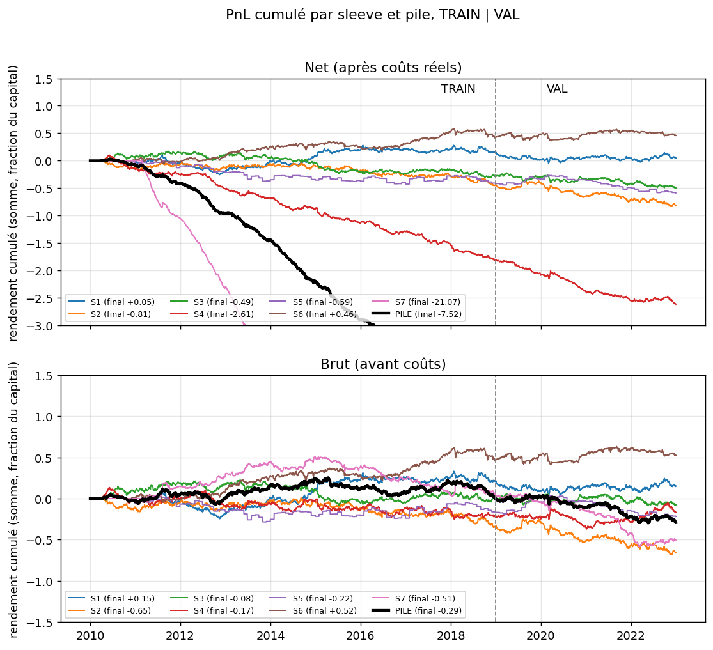
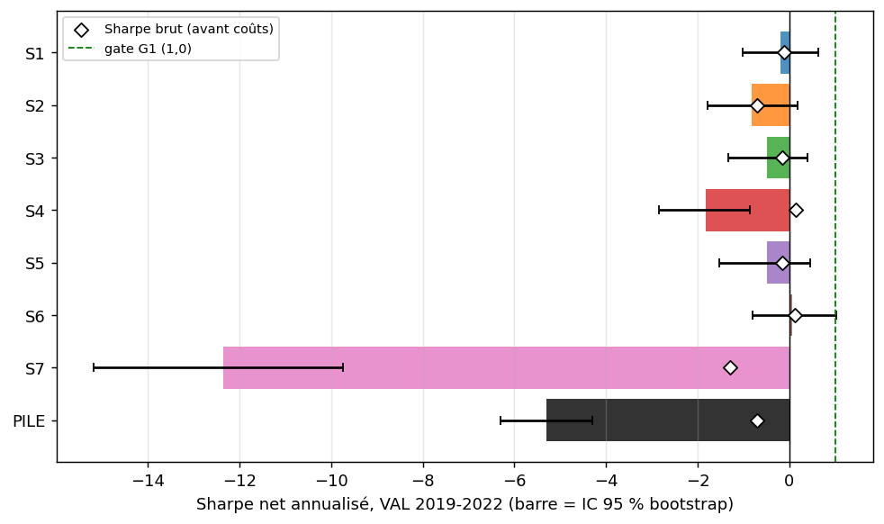
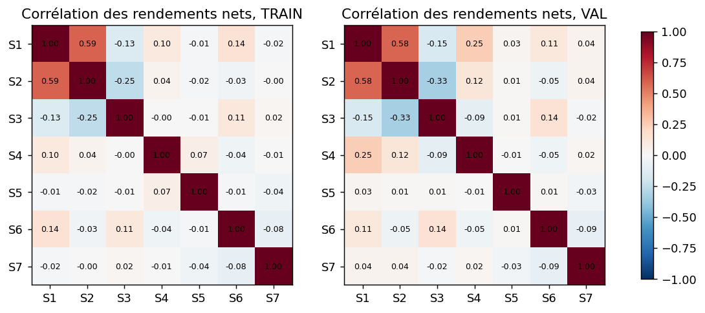
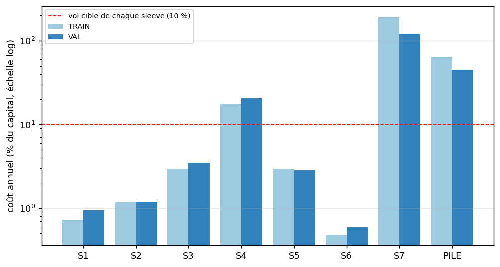

# Résultats détaillés (TRAIN / VAL, TEST scellé)

Page de détail du [README](../README.md) : tous les chiffres par sleeve et pour la pile, les gates, les figures de lecture. Les tableaux ci-dessous sont **générés** par `scripts/generer_readme_tete.py` depuis `results/` (rien n'est tapé à la main). VAL = période d'évaluation, déjà vue lors d'un projet antérieur (voir « Pré-enregistrement » dans le README) ; le TEST n'est jamais chargé.

<!-- AUTO:DETAIL -->
Chiffres lus dans [`results/train_val.json`](../results/train_val.json) (VAL = 1 044 jours ; Sharpe net annualisé, coûts réels déduits).

| Série | Début actif | Sharpe net TRAIN | Sharpe net VAL | IC 95 % bootstrap VAL | Sharpe brut VAL | t NW VAL | p Holm | PSR(0) | DSR (N = 8) |
|---|---|---|---|---|---|---|---|---|---|
| S1 Trend following | 2010-12-29 | 0,16 | −0,20 | [−1,02 ; 0,64] | −0,12 | −0,41 | 1,000 | 0,341 | < 0,001 |
| S2 Momentum devises | 2010-04-06 | −0,46 | −0,82 | [−1,78 ; 0,19] | −0,71 | −1,59 | 0,555 | 0,049 | < 0,001 |
| S3 Retournement devises | 2010-04-06 | −0,31 | −0,49 | [−1,34 ; 0,40] | −0,15 | −1,02 | 1,000 | 0,158 | < 0,001 |
| S4 Saisonnalité FX | 2010-04-01 | −1,91 | −1,81 | [−2,85 ; −0,87] | 0,14 | −3,75 | 0,001 | 0,000 | < 0,001 |
| S5 Fixing fin de mois | 2010-11-30 | −0,47 | −0,49 | [−1,52 ; 0,46] | −0,15 | −1,01 | 1,000 | 0,159 | < 0,001 |
| S6 Actions vol-gérées | 2010-12-02 | 0,52 | 0,07 | [−0,80 ; 1,02] | 0,12 | 0,14 | 1,000 | 0,553 | < 0,001 |
| S7 Momentum SPX intraj. | 2011-02-24 | −15,60 | −12,34 | [−15,18 ; −9,74] | −1,29 | −19,49 | 0,000 | 0,000 | < 0,001 |
| **PILE (7 sleeves)** | 2011-02-24 | −6,48 | −5,30 | [−6,31 ; −4,30] | −0,70 | −10,20 | n/a | 0,000 | < 0,001 |

| Série | Rend. net/an VAL | Vol/an VAL | DD max VAL | Rotation/an VAL | Coût/an VAL | Sharpe brut TRAIN | Rend. net/an TRAIN | Coût/an TRAIN |
|---|---|---|---|---|---|---|---|---|
| S1 Trend following | −2,2 % | 11,0 % | −19 % | 34× | 0,9 % | 0,23 | 1,7 % | 0,7 % |
| S2 Momentum devises | −8,9 % | 10,9 % | −39 % | 94× | 1,2 % | −0,35 | −4,9 % | 1,2 % |
| S3 Retournement devises | −5,0 % | 10,2 % | −26 % | 268× | 3,5 % | −0,02 | −3,2 % | 3,0 % |
| S4 Saisonnalité FX | −19,0 % | 10,5 % | −56 % | 2 221× | 20,5 % | −0,24 | −20,1 % | 17,6 % |
| S5 Fixing fin de mois | −4,1 % | 8,3 % | −28 % | 474× | 2,9 % | −0,19 | −5,0 % | 3,0 % |
| S6 Actions vol-gérées | 0,7 % | 10,1 % | −15 % | 5× | 0,6 % | 0,56 | 5,2 % | 0,5 % |
| S7 Momentum SPX intraj. | ruine (< −100 %) | 10,9 % | −100 % | 1 010× | 121,2 % | 0,03 | ruine (< −100 %) | 191,3 % |
| **PILE (7 sleeves)** | −52,4 % | 9,9 % | −89 % | 1 349× | 45,5 % | 0,01 | −64,8 % | 64,9 % |

*« ruine » : rendement annuel (moyenne quotidienne × 252) inférieur à −100 %, voir la note du README.*

Poids de la pile et contribution de chaque sleeve (purement descriptif) :

| Sleeve | Poids de la pile (∝ 1/vol TRAIN) | Contribution annuelle au rendement net de la pile, VAL |
|---|---|---|
| S1 Trend following | 0,140 | −0,7 % |
| S2 Momentum devises | 0,144 | −3,0 % |
| S3 Retournement devises | 0,150 | −1,8 % |
| S4 Saisonnalité FX | 0,145 | −6,5 % |
| S5 Fixing fin de mois | 0,145 | −1,4 % |
| S6 Actions vol-gérées | 0,152 | 0,2 % |
| S7 Momentum SPX intraj. | 0,125 | −39,2 % |

| Gate | Critère | Valeur | Résultat |
|---|---|---|---|
| G1 | Sharpe net VAL de la pile ≥ 1,0 | −5,30 | ÉCHOUE |
| G2 | borne basse IC 95 % bootstrap du Sharpe VAL > 0 | −6,31 | ÉCHOUE |
| G3 | DSR VAL (N = 8) ≥ 0,95 | < 0,001 | ÉCHOUE (non informatif : Sharpe négatif) |
| G4 | TEST : Sharpe net > 0 et ≥ 0,5 × Sharpe VAL | non évalué | TEST scellé (G1 et G2 échouent) |
<!-- /AUTO:DETAIL -->

**Verdict : `ECHEC`**, TEST non ouvert (`scelle_G1_ou_G2_en_echec`). Détail dans [`results/verdict_alpha.json`](../results/verdict_alpha.json). Le TEST n'est ouvert que si G1 et G2 passent ; elles échouent, donc il reste scellé. `scripts/ouvrir_test.py` est écrit mais n'a **jamais été exécuté**. La gate G3 (DSR) n'est pas informative ici : le Sharpe de la pile est négatif, donc DSR = 0 quel que soit le nombre d'essais.

**Comment lire ce graphique.** En haut, le PnL cumulé net de frais (somme des rendements quotidiens, en fraction du capital) de chaque sleeve et de la pile ; en bas, le même brut, avant frais. La ligne pointillée sépare TRAIN (gauche) de VAL (droite). L'écart entre les deux panneaux, c'est le coût : faible pour les sleeves lentes (S1, S6), dévorant pour les rapides (S4, S7). Les séries qui sortent du cadre sont rognées, leur valeur finale est dans la légende.

**Comment lire ce graphique.** Une barre par série : Sharpe net sur VAL avec son IC à 95 % (bootstrap) ; le losange blanc est le Sharpe brut, avant frais. La ligne verte est le seuil de la gate G1 (Sharpe 1). Un intervalle qui contient zéro veut dire « indistinguable de zéro » ; aucune barre n'approche la ligne verte, et les losanges (brut) sont déjà au plus à 0,14.

**Comment lire ce graphique.** Corrélation entre les rendements nets quotidiens des sleeves, TRAIN à gauche, VAL à droite (rouge = positive, bleu = négative). Des sleeves peu corrélées se diversifient bien, mais à condition d'avoir chacune un edge ; la seule corrélation notable est S1-S2 (0,58 en VAL).

**Comment lire ce graphique.** Coût annuel en pourcentage du capital (échelle logarithmique). La ligne rouge est la volatilité cible de chaque sleeve (10 %) : une sleeve dont le coût dépasse cette ligne paie plus en frais qu'elle ne prend de risque. S4 et S7 sont bien au-dessus.

## Lecture détaillée

- **La pile est loin des gates** : Sharpe net VAL −5,30 (IC 95 % [−6,31 ; −4,30]), Sharpe brut VAL −0,70. Même avant coûts, la pile ne gagne pas d'argent en VAL : le problème n'est pas uniquement les coûts. (Reconstruite à coût nul dans l'analyse de sensibilité, la pile donne −0,75 : les poids sont recalculés à chaque multiple de coût, d'où l'écart avec le −0,70 de la pile officielle.)
- **Une sleeve écrase tout** : S7 a un gain brut moyen par trade nul ou négatif (≈ 0 bp en TRAIN, −1,9 bp en VAL), face à 2 × 12 bps de coût multipliés par le levier qu'impose une vol cible de 10 % sur une demi-heure d'exposition. Son coût annuel en VAL est de 121 % du capital pour une vol de 10 %. La pile à poids ∝ 1/vol lui donne le même poids qu'aux autres ; elle porte environ 75 % de la perte annuelle de la pile (−39,2 points sur −52,4). Retirer S7 « pour voir » est précisément ce que le protocole interdit : ce serait un nouveau pré-enregistrement avec N cumulé.
- **S4 : un signal brut quasi nul que les coûts transforment en perte nette** : Sharpe brut VAL 0,14 (0,58 avant la correction de l'horloge, avenant 1), Sharpe net VAL −1,81. Le gain brut par trade est inférieur au coût aller-retour sur les 6 paires (VAL : +0,40 bp pour EURUSD contre 0,97 bp de coût).
- **Les sleeves quotidiennes (S1, S2, S3, S6) sont indiscernables de zéro ou négatives en VAL** : aucune ne passe Holm. S2 est négative aussi en TRAIN ; une vérification indépendante (spread hebdomadaire équipondéré, sans le moteur du dépôt) donne le même signe. S6 est la meilleure en TRAIN (Sharpe net 0,52) mais son Sharpe VAL (0,07) ne se distingue pas de zéro.
- **Corrélations faibles, sauf S1-S2** (0,58 en VAL) : corrélation moyenne VAL 0,026. Décorréler des sleeves sans edge ne produit pas d'edge.
- **Biais corrigés par construction** : aucun fill au prix du signal (un jour plein de décalage, une minute en intrajournalier), coûts réels dès le premier calcul, pas de sélection (paramètres figés, N = 8 compté dans le DSR), Sharpe toujours accompagné d'un IC bootstrap, test de causalité de bout en bout.

## Pourquoi Sharpe > 2 n'est pas atteint

Pour N sleeves de même Sharpe `s` et de corrélation moyenne `ρ`, le Sharpe de la pile équipondérée vaut `s·√N / √(1 + (N−1)·ρ)`.

- Il faudrait **0,81 de Sharpe net par sleeve** (N = 7, ρ̄ = 0,026 observé en VAL) ; le meilleur Sharpe net VAL est celui de S6 (0,07).
- À Sharpe individuel 0,3 il faudrait 45 sleeves indépendantes ; à 0,5, 16.
- Les coûts réels absorbent tout ce qui tourne vite : S3 (268× de rotation par an), S4 (2 221×), S7 (1 010×). Les sleeves lentes (S1, S6) ne coûtent presque rien, mais ne rapportent presque rien non plus.
- Sur 4 ans de VAL, l'erreur standard d'un Sharpe annualisé est d'environ 0,5 (IC 95 % d'environ ±1) : un Sharpe de 0,5 sur une sleeve n'est pas distinguable de zéro, d'où l'intérêt du bootstrap et de Holm.
